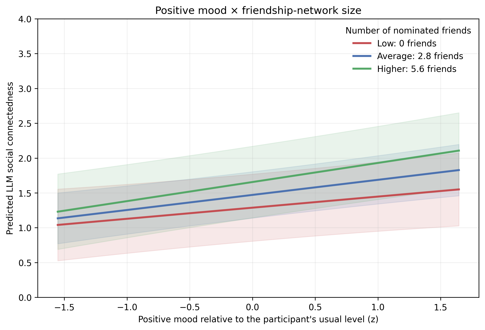

# Language-Based Indicators of Social Relationship Perception in Depression and Anxiety

**A Computational Social Science Approach Using Natural Language Processing**  
*M.Sc. Thesis in Computational Social Systems (Social Data Science), RWTH Aachen University (2026)*  
**Author:** Tasnim Tabassum | [Portfolio](https://tabassum-tasnim.github.io/) | [Google Scholar](https://scholar.google.com/citations?hl=en&user=iG6eCN8AAAAJ) | [LinkedIn](https://www.linkedin.com/in/towmony)

---

## Overview

This repository contains the evaluation framework, statistical modeling notebooks, and regression outputs for my Master's thesis at the Institute of Sociology, RWTH Aachen University. The study investigates whether Large Language Models (LLMs) can reliably measure latent psychological and relational states—specifically **expressed social connectedness**—from naturalistic longitudinal language data in clinical and subclinical populations.

### Key Methodology & Findings
* **Longitudinal Naturalistic Dataset:** Analyzed **429 German audio-diary transcripts** collected across **40 participants** experiencing varying levels of depression (`PHQ`) and anxiety (`GAD`) symptoms.
* **Psychometric Validation Against Human Coders:** Evaluated LLM-derived social connectedness ratings against blinded human annotations, achieving strong inter-rater agreement (**$\text{ICC}(A,1) = 0.81$** across 67 codable diary entries).
* **Prompt & Run-to-Run Reliability:** Tested repeated-run stability (**Pearson $r = 0.98$**) and examined boundary conditions where sparse textual context limits automated psychological inference.
* **Multilevel Statistical Modeling:** Applied **linear mixed-effects models** in Python to decompose **within-person** (moment-to-moment) fluctuations from **between-person** (trait-level) differences linking social connectedness, positive/negative affect (`PA`/`NA`), and `PHQ`/`GAD` symptom severity.

---

## Key Results & Visualizations

### Within-Person Association: Social Connectedness & Positive Affect (`PA`)


### Within-Person Association: Social Connectedness & Negative Affect (`NA`)


---

## Repository Structure

```text
├── code/
│   └── Data_Analysis_&_Exploration.ipynb        # Data cleaning, reliability checks & linear mixed-effects models
├── data/
│   └── README.md                                # Data governance, anonymization & GDPR access restrictions
├── figures/
│   ├── Figure_PA_within_friends_LLM_common429.png
│   ├── Figure_PA_within_friends_LLM_prediction_data.xlsx
│   ├── Figure_NA_within_friends_LLM_common429.png
│   └── Figure_NA_within_friends_LLM_prediction_data.xlsx
├── results/
│   ├── Family1_separate_mood_models_full_common429.xlsx
│   ├── Family2_mixed_models_common429.xlsx
│   ├── Family3_joint_PHQ_GAD_common429.xlsx
│   ├── Family3_separate_models_full_common429.xlsx
│   ├── Table_2_expanded_correlations_common429.xlsx
│   └── Table_5_Family3_separate_PHQ_GAD_common429.xlsx
├── requirements.txt
└── LICENSE
```

---

## Data Availability & Privacy

Due to clinical sensitivity and GDPR data-protection regulations governing participant audio diaries, raw transcripts cannot be published publicly. See [`data/README.md`](data/README.md) for dataset schema details, and refer to `figures/` and `results/` for aggregated model predictions and regression tables.

---

## Setup & Reproducibility

```bash
git clone [https://github.com/tabassum-tasnim/masters-thesis-social-connectedness.git](https://github.com/tabassum-tasnim/masters-thesis-social-connectedness.git)
cd masters-thesis-social-connectedness
pip install -r requirements.txt
jupyter notebook "code/Data_Analysis_&_Exploration.ipynb"
```

---

## Citation

```bibtex
@mastersthesis{tabassum2026connectedness,
  author  = {Tabassum, Tasnim},
  title   = {Language-Based Indicators of Social Relationship Perception in Depression and Anxiety: A Computational Social Science Approach Using Natural Language Processing},
  school  = {RWTH Aachen University},
  year    = {2026},
  type    = {M.Sc. Thesis in Computational Social Systems}
}
```
