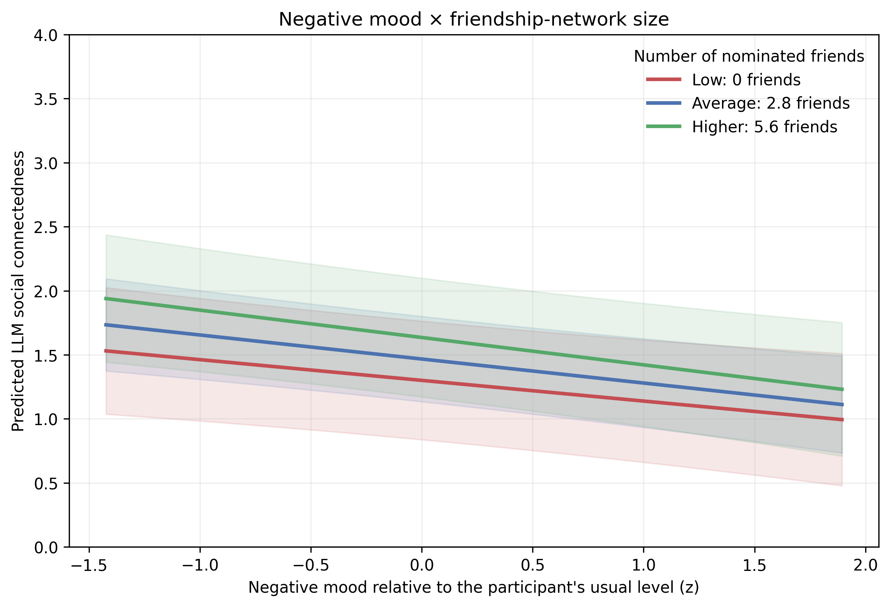

# Social Connectedness in Naturalistic Language

*Master's Thesis · M.Sc. Computational Social Systems · RWTH Aachen University · 2026*

**Full thesis title:** Language-Based Indicators of Social Relationship Perception in Depression and Anxiety: A Computational Social Science Approach Using NLP

**Tasnim Tabassum** · [Portfolio](https://tabassum-tasnim.github.io/) · [Google Scholar](https://scholar.google.com/citations?hl=en&user=iG6eCN8AAAAJ) · [LinkedIn](https://www.linkedin.com/in/towmony)


## Overview

This repository contains the statistical modeling notebooks, evaluation outputs, and figures for my Master's thesis at RWTH Aachen University. The study investigates whether a Large Language Model (LLM) can serve as a valid, reproducible measurement instrument for a latent relational construct—**expressed social connectedness**—in naturalistic open-ended diary language, and what it adds beyond sentiment and lexical baselines.

The public notebook documents the final statistical analysis, model evaluation and robustness checks performed for the thesis. The initial transcript-processing and LLM annotation workflows are not included in this release. The notebook begins from saved analytical checkpoints, while aggregate results and figures are available for inspection.

## Methods and Key Findings
* **Intensive Longitudinal EMA Dataset:** Analyzed **429 naturalistic German audio-diary transcripts** from **40 university students** in the *PeerSmart Network Study* (a one-week smartphone ecological momentary assessment with momentary mood ratings and baseline `PHQ-9` depression and `GAD-7` anxiety scores).
* **Structured LLM Instrument & Empirical Facet Selection:** Evaluated four dimensions of expressed social connectedness (*direct social connection*, *engagement with others*, *relationship quality*, and *belonging*) on a `0–4` scale using Azure OpenAI (`gpt-5-chat`). Excluded *belonging* on empirical grounds due to weaker inter-prompt correlations and a distinct distributional pattern, yielding a high-consistency **3-item composite ($\alpha = .976$)**.
* **Human Validation & Repeated-Run Reliability:** Compared LLM-generated social-connectedness ratings with blinded coding by a single human rater across 67 codable diary entries (ICC(A,1) = .807). Assessed repeated-run consistency of the LLM ratings (Pearson r = .980). These findings provide evidence of agreement and stability but do not independently establish construct validity.
* **Baseline Comparisons & Multilevel Modeling:** Estimated within-between random-effects (`REWB`) linear mixed-effects models (with cluster-robust OLS robustness checks) in Python (`statsmodels`), comparing the LLM indicator against **`oliverguhr/german-sentiment-bert`** and custom German lexical-density baselines:
  * Higher-than-usual **within-person positive mood** predicted higher LLM-rated social connectedness (**$b = 0.228, p < .001$**), while higher **within-person negative mood** predicted lower ratings in separate models (**$b = -0.186, p < .001$**).
  * Neither baseline `PHQ-9` nor `GAD-7` was clearly associated with LLM-rated connectedness—whereas general BERT sentiment captured broader within- and between-person affective and symptom-level variance, and lexical-density indicators were sparser and less stable.


For detailed model specifications, analytical decisions and an overview of the three model families, see the [Statistical Analysis Strategy](docs/analysis_strategy.md).

## Interpretation and Limitations

The results provide evidence that LLM-generated connectedness ratings are consistent and associated with momentary mood variation. However, several limitations are important:

- **Construct validity:** High internal consistency, agreement with human judgments and repeated-run stability do not establish that the ratings uniquely measure social connectedness rather than related linguistic or affective characteristics.
- **Human evaluation:** Validation involved a single human rater and 67 codable diary entries. Agreement estimates should therefore not be interpreted as evidence of reliability across multiple human annotators.
- **Observational evidence:** Within-person associations with mood are correlational. They do not establish causal relationships or demonstrate that the measure can distinguish psychological states from stable individual characteristics.

These limitations motivate further research involving independent human raters, stronger discriminant validation and longitudinal evaluation across participants and contexts.


## Results and Figures

**Positive affect and LLM-rated social connectedness**


**Negative affect and LLM-rated social connectedness**




## Repository Structure

```text
.
├── code/
│   └── Data_Analysis_&_Exploration.ipynb
├── examples/
│   └── synthetic_longitudinal_demo.py
├── data/
│   └── README.md
├── figures/                       # Aggregate visualizations
├── results/                       # Statistical result tables
├── .github/workflows/
│   └── synthetic-demo.yml         # Automated reproducibility test
├── requirements-demo.txt          # Tested synthetic-demo dependencies
├── requirements.txt               # Broader thesis dependencies
└── LICENSE
```

The original analysis notebook requires restricted data. The synthetic example runs independently using the dependencies in `requirements-demo.txt`.

## Data Availability & Privacy

Due to participant privacy and GDPR data-protection regulations governing audio-diary transcripts from the *PeerSmart Network Study*, raw text transcripts cannot be shared publicly. See [`data/README.md`](data/README.md) for dataset schema details, and refer to `figures/` and `results/` for aggregated model predictions and regression tables.

## Reproducible Synthetic Demonstration

A standalone example is available in
[`examples/synthetic_longitudinal_demo.py`](examples/synthetic_longitudinal_demo.py).

It demonstrates within-person and between-person decomposition using a random-intercept linear mixed-effects model.

The script generates 480 artificial observations from 40 simulated participants. It separates each participant's mean mood from momentary deviations around that mean and estimates their associations with a simulated connectedness outcome.

### Run the demonstration

From the repository root, after installing the dependencies in `requirements-demo.txt`, run:

```bash
python examples/synthetic_longitudinal_demo.py
```

### Expected output

The script prints the sample size and a `statsmodels` mixed-effects regression summary, including coefficients for:

- `mood_within`: within-person association
- `mood_between`: between-person association

All data are generated with a fixed random seed.

**Important:** This is a methodological illustration only. The simulated observations, coefficients and results are not derived from the original thesis dataset. The example does not validate the LLM measurement instrument or reproduce the original empirical findings.


## Environment Setup and Reproducibility

Clone the repository and install the dependencies:

```bash
git clone https://github.com/tabassum-tasnim/masters-thesis-social-connectedness.git
cd masters-thesis-social-connectedness

python -m venv .venv

# Linux/macOS
source .venv/bin/activate

# Windows
# .venv\Scripts\activate

pip install -r requirements-demo.txt
```

**Publicly reproducible example**

Run the synthetic longitudinal analysis:

```bash
python examples/synthetic_longitudinal_demo.py
```

This example is self-contained and does not require access to the original research data.

**Original thesis analysis**

The original statistical notebook is located at:

`code/Data_Analysis_&_Exploration.ipynb`

It requires restricted analytical checkpoints, including participant-level observations, survey measures and LLM-generated ratings.

The notebook expects these checkpoints inside a local `Data Sharing/` directory.

These files are not publicly distributed because of research ethics and data-protection restrictions.

The original analysis therefore cannot be reproduced from the public repository alone. Aggregate statistical results and figures remain available for inspection.


## Citation

```bibtex
@mastersthesis{tabassum2026connectedness,
  author  = {Tabassum, Tasnim},
  title   = {Language-Based Indicators of Social Relationship Perception in Depression and Anxiety: A Computational Social Science Approach Using NLP},
  school  = {RWTH Aachen University},
  year    = {2026},
  type    = {M.Sc. Thesis in Computational Social Systems}
}
```
